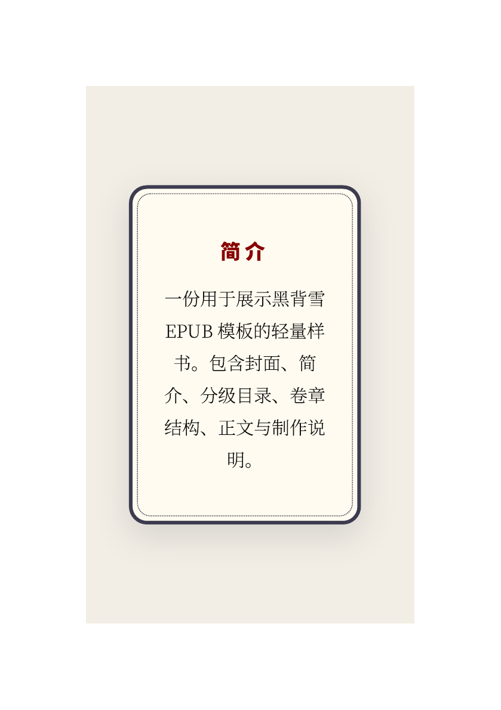
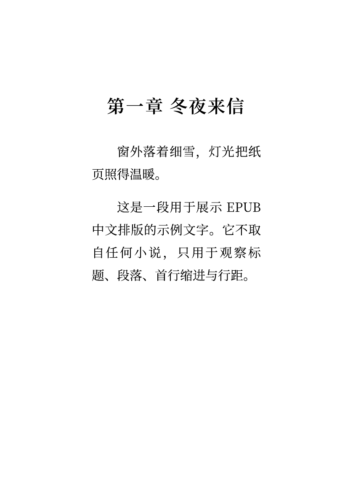

# 黑背雪 EPUB 工坊

用于分享黑背雪制作的 EPUB、可复用排版模板，以及 EPUB 检查与修复工具。

**把中文 TXT 整理成可阅读的 EPUB，也为已有 EPUB 排查结构问题。**

[排版预览](#排版效果预览) · [制作 EPUB](#使用-txt-转-epub-模板) · [检查与修复](#检查已有-epub) · [版权规则](BOOKS_POLICY.md)

| 你的需求 | 推荐入口 |
| --- | --- |
| 有中文小说 TXT，希望生成封面、简介与分级目录 | `txt-to-epub-template` |
| 已有 EPUB 打不开或导入失败，希望检查包装与引用 | `epub-repair` |
| 想下载整理好的书籍 | 当前书目为空，本仓库暂以工具和模板为主。 |

这是脚本与 Agent Skills 项目，不是带图形界面的阅读器。可以直接使用 Python 命令行，也可以安装 Skill 后交给 Codex 执行。

## 当前内容

- `skills/txt-to-epub-template`：把中文小说 TXT 制作为带封面、简介、制作说明、目录和章节页的 EPUB 3。
- `skills/epub-repair`：检查并安全修复 EPUB 的 ZIP 包装、container、OPF、manifest、spine 和导航引用。
- `books/`：存放原创、已获授权或公版 EPUB 的清单及发布说明。

当前仓库首版只发布工具和模板，不包含商业小说正文。

## 排版效果预览

以下页面由仓库内的 TXT 转 EPUB 模板生成，文字均为原创示例，不含商业小说正文。实际阅读时，正文背景会跟随阅读器主题。

| 封面 | 简介 | 制作说明 |
| --- | --- | --- |
|  |  |  |

| 卷页 | 正文 |
| --- | --- |
|  |  |

## 使用 TXT 转 EPUB 模板

先下载仓库（**Code → Download ZIP**）并解压，或使用 Git 克隆；在仓库根目录打开终端。需要 Python 3.10 或以上，两份核心脚本使用 Python 标准库，无需先安装额外 Python 包。

TXT 需要有可识别的卷章标题，例如“第一卷”“第一章”“尾声”“番外”。模板会据此生成目录；转换后请在自己的阅读器中抽查章节和目录跳转。封面参数可省略，省略时生成文字 SVG 封面。

在 Codex 中可以直接说：

```text
使用 $txt-to-epub-template，把这份中文小说 TXT 制作为 EPUB。
```

也可以直接运行：

```powershell
python skills/txt-to-epub-template/scripts/txt_to_epub.py "原稿.txt" `
  --title "书名" `
  --author "作者" `
  --cover "封面.jpg" `
  --output "书名.epub"
```

运行：

```powershell
python skills/txt-to-epub-template/scripts/txt_to_epub.py --help
```

可查看封面、简介、制作团队、版本、日期、来源与排版致谢等参数。

## 安装 Skills

将需要的 Skill 文件夹复制到个人 Codex Skills 目录，或从本仓库安装。每个 Skill 都包含自己的 `SKILL.md`、脚本和资源文件。

Windows 用户可将所需的整个文件夹复制到 `%USERPROFILE%\.codex\skills\`，保留文件夹名，例如 `txt-to-epub-template`，然后重启 Codex。只运行命令行脚本无需安装 Skill。

详细流程见 [TXT 转 EPUB Skill](skills/txt-to-epub-template/SKILL.md) 和 [EPUB 修复 Skill](skills/epub-repair/SKILL.md)。

## 检查已有 EPUB

在仓库根目录运行，默认只检查：

```powershell
python skills/epub-repair/scripts/epub_check_repair.py "待检查.epub"
```

需要修复时，明确指定新输出文件：

```powershell
python skills/epub-repair/scripts/epub_check_repair.py "待检查.epub" --repair --output "修复版.epub"
```

修复范围是 ZIP 包装和可确定的基础结构问题，不保证修复所有损坏，也不负责重新校对正文或绕过 DRM。生成后仍需核对检查结果并在目标阅读器中打开确认。

## 版式致谢

模板的制作说明与简介页参考鬼鬼制作的《塞壬之刃》；正文背景和封面适配参考湖心溪露制作的《我的超能力每周刷新》。生成的制作说明页默认保留排版参考致谢。

本仓库与上述制作者及作品不存在官方隶属或授权关系，引用仅用于说明版式灵感来源。

## 版权规则

只接受以下 EPUB：

1. 上传者拥有完整版权的原创作品；
2. 已获得作者或版权方明确公开授权的作品；
3. 已进入公有领域的作品；
4. 许可证明确允许再分发的作品。

请勿提交来源不明、购买获得、平台抓取或未经许可传播的商业小说。详细要求见 [BOOKS_POLICY.md](BOOKS_POLICY.md)。

## 许可证

仓库中的脚本、Skill 指令和通用样式以 [MIT License](LICENSE) 发布。书籍内容不自动适用 MIT；每本书必须在 `books/catalog.yml` 中单独声明权利状态与许可证。
